<p align="center">
  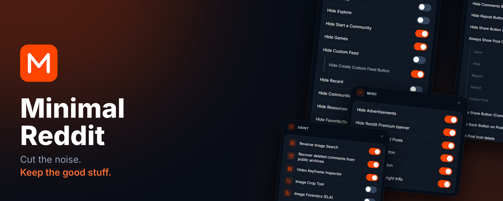
</p>

<p align="center">
  A browser extension that strips the clutter out of new Reddit, adds a set of media and OSINT tools, and lets you restyle the site.<br>
  Everything is a toggle in the popup. Everything runs locally.
</p>

<p align="center">
  <b>v1.0.0</b> &nbsp;·&nbsp; Chrome 120+ &nbsp;·&nbsp; Firefox 140+ &nbsp;·&nbsp; Manifest V3 &nbsp;·&nbsp; MIT
</p>

---

<div align="center">

<table>
  <tr>
    <th colspan="4">Gecko</th>
    <th colspan="4">Chromium</th>
  </tr>
  <tr>
    <td align="center">Firefox</td>
    <td align="center">Edge</td>
    <td align="center">Chrome</td>
    <td align="center">Brave</td>
    <td align="center">Vivaldi</td>
  </tr>
  <tr>
    <td align="center"></td>
    <td align="center"></td>
    <td align="center"></td>
    <td align="center"></td>
    <td align="center"></td>
  </tr>
  <tr>
    <td align="center"><a href="#install">Coming soon</a></td>
    <td align="center"><a href="#install">Coming soon</a></td>
    <td align="center"><a href="#install">Coming soon</a></td>
    <td align="center"><a href="#install">Coming soon</a></td>
    <td align="center"><a href="#install">Coming soon</a></td>
  </tr>
</table>

</div>

---

## Contents

[Overview](#overview) · [OSINT tools](#osint-tools) · [Quality of life](#quality-of-life) · [Everything else](#everything-else) · [Install](#install) · [Privacy](#privacy) · [Limitations](#limitations) · [Development](#development)

---

## Overview

The popup is split into three tabs: **Tools** for the features that add something, **Declutter** for the ones that take something away, and **Style** for how the page looks. There is a search box at the top if you know what you're after.

70+ options, all off or on individually, no account, no telemetry.

<p align="center">
  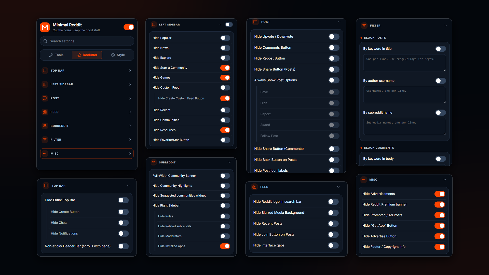
</p>
<p align="center">
  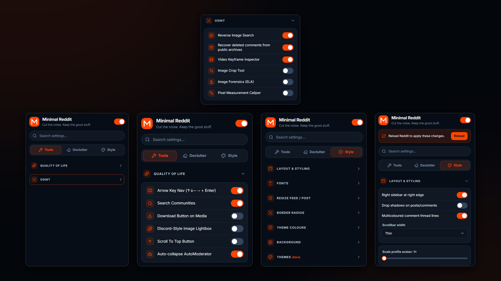
</p>

---

## OSINT tools

Built for people who verify what they see on Reddit. Each tool is opt-in and adds a small button to the top corner of image and video posts.

<p align="center">
  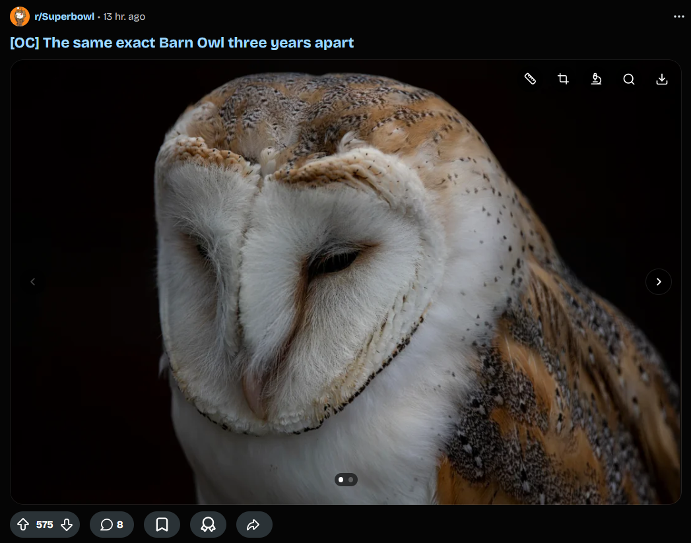
</p>

### Recover deleted comments

Removed and deleted comments get a **Recover comment text** button. It looks the comment up in public archives (PullPush first, Arctic Shift as fallback) and shows the recovered text inline, with the archive source, the archive date and the original author.

<p align="center">
  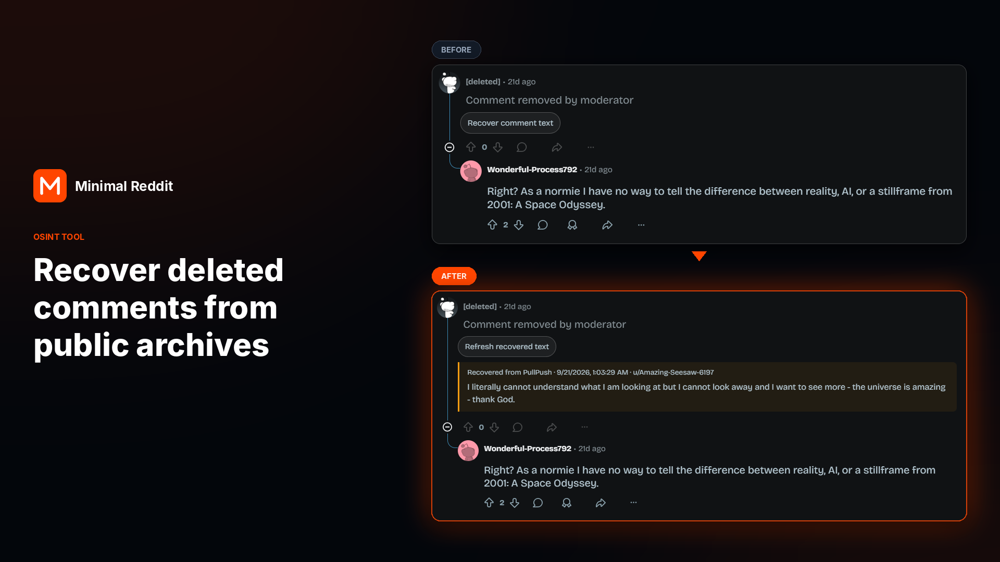
</p>

Only the comment ID leaves your browser, and only when you click the button.

### Image forensics (ELA)

Runs Error Level Analysis on any image and shows it next to the original. You control JPEG quality and amplification, and can download the result. Also available from the right-click menu on any image.

Areas that were edited or pasted in tend to recompress differently from the rest of the frame, which is what ELA makes visible. It is a hint, not proof, and the tool says so.

<table>
  <tr>
    <td width="50%">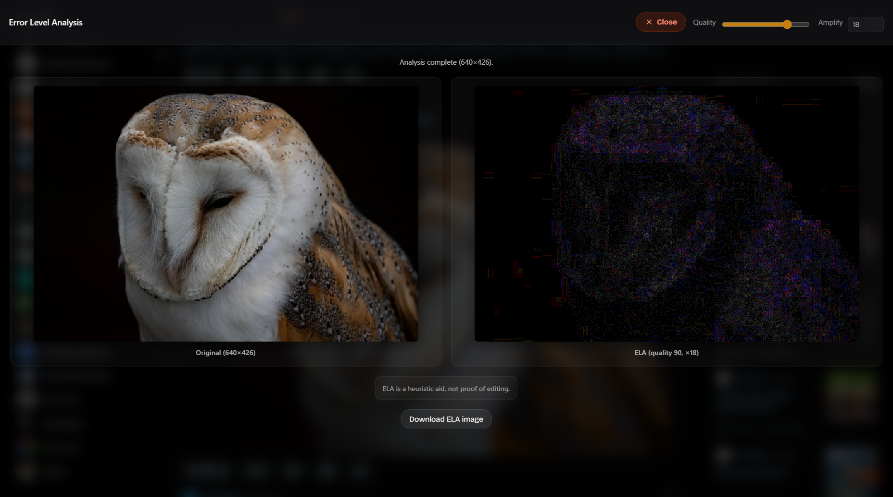</td>
    <td width="50%">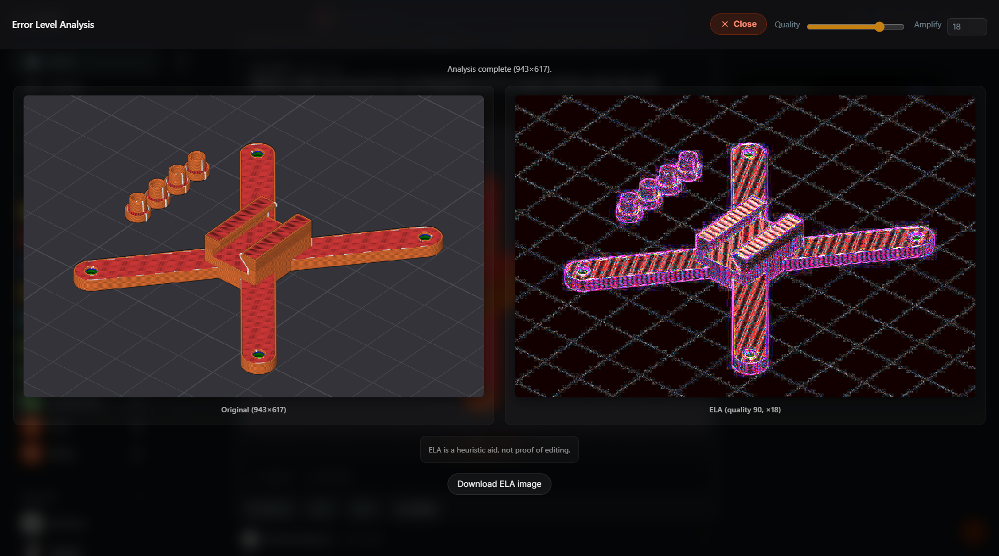</td>
  </tr>
</table>

### Everything else in the OSINT group

| Tool | What it does |
|---|---|
| **Reverse image search** | Opens Google Lens, Yandex, TinEye or Bing in a new tab with the image URL. |
| **Video keyframe inspector** | Step through a video frame by frame and pull out stills. |
| **Image crop tool** | Select a region and save it at the image's real pixel size. |
| **Pixel measurement caliper** | Draw lines on an image and read off distances in m, cm, mm, ft, in or yd. Assumes everything sits on one flat plane, so treat numbers as estimates. |

The crop, caliper and forensics scripts are loaded into the tab only when you open them.

---

## Quality of life

Small things that make the site less annoying to use.

| Feature | Details |
|---|---|
| **Arrow-key navigation** | `↑` `↓` move between posts, `←` `→` step through galleries or seek video, `Enter` opens the post. |
| **Search communities** | Adds a search field to the communities list in the left nav. |
| **Download button on media** | One click download for images and video. |
| **Auto-collapse AutoModerator** | Pinned bot comments start collapsed. |
| **Scroll-to-top button** | Optional. |
| **Discord-style image lightbox** | Click an image to open it in a full-screen viewer with a counter, arrow navigation and download, open and search buttons. |

<p align="center">
  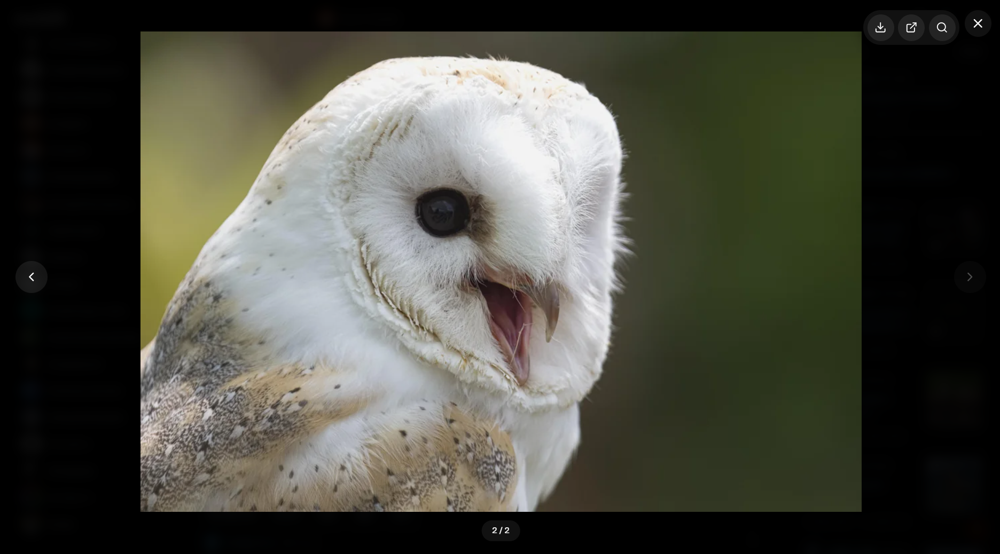
</p>

### Right-click menu

| Item | On | Action |
|---|---|---|
| Copy clean link | Reddit links | Copies the URL with tracking parameters removed. |
| Analyze image (ELA) | Images | Opens Error Level Analysis. |
| Download media | Images, video | Saves the file. |

---

## Everything else

### Post controls

Reddit's overflow menu hides most post actions. **Always show post options** pulls Save, Hide, Report, Award and Follow Post back onto the post itself, each one switchable on its own.

<p align="center">
  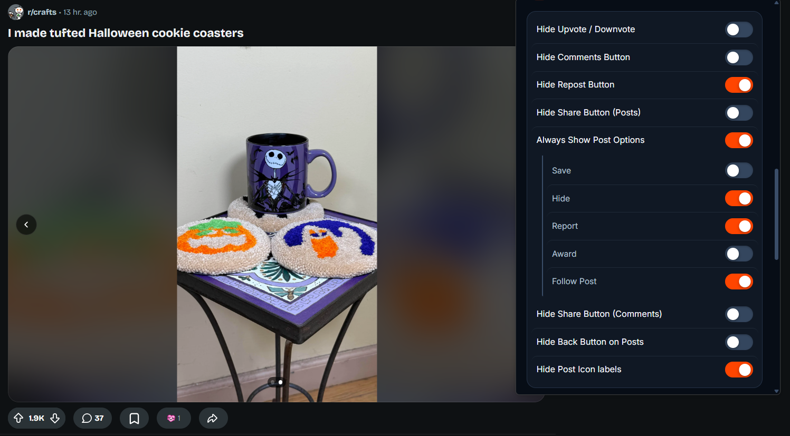
</p>

**Award is back.** Reddit swapped the Award button for Repost. With this enabled you get the Awards button back on posts (the count shows on the post below), and Repost can be hidden separately.

<p align="center">
  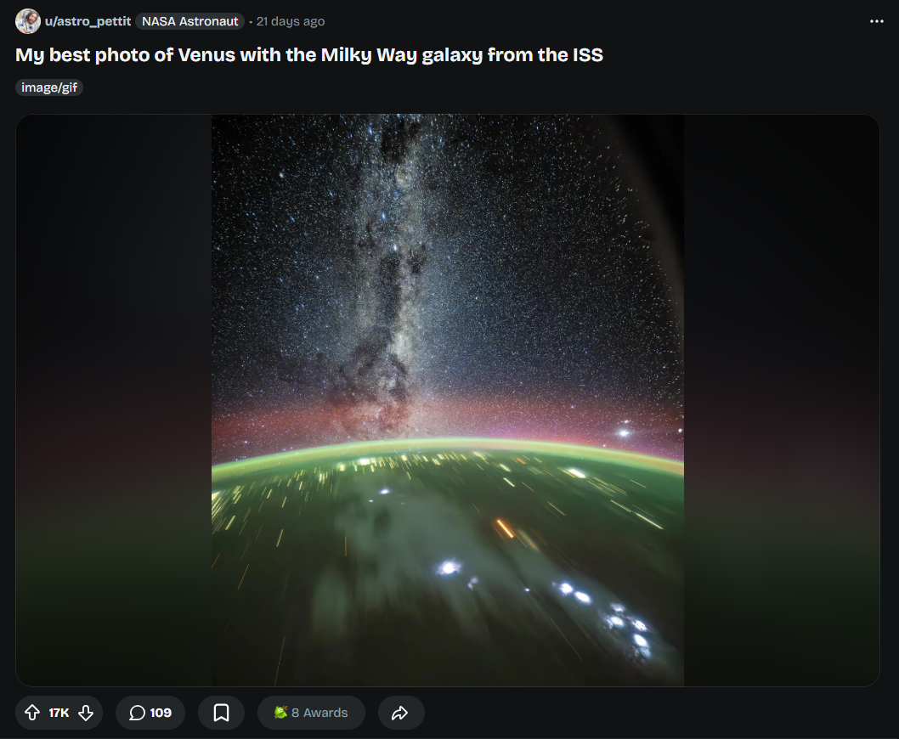
</p>

### Declutter

| Area | Options |
|---|---|
| **Top bar** | Hide the entire bar, Create, Chats, Notifications. Non-sticky header. Hide the Reddit logo in the search bar. |
| **Left sidebar** | Hide Popular, News, Explore, Start a Community, Games, Custom Feed (and its create button), Recent, Communities, Resources, Favorite/Star. |
| **Right sidebar** | Hide the whole thing, or just Rules, Related subreddits, Moderators, Installed Apps. |
| **Posts** | Hide vote buttons, comments, repost, share (posts and comments separately), the back button, icon labels, the Join button, Follow Post. |
| **Feed** | Hide blurred media backgrounds, Recent Posts, interface gaps. |
| **Subreddit** | Full-width community banner. Hide community highlights and the suggested communities widget. |
| **Ads and promos** | Advertisements, promoted posts, Reddit Premium banner, "Get App" button, Advertise button, footer. |

### Filter

Block posts by title keyword, author or subreddit, and block comments by body keyword or author. One entry per line. Wrap a line in slashes for a regex, like `/free\s+vbucks/i`. Regexes that could hang the page are rejected.

### Style

| Area | Options |
|---|---|
| **Layout** | Default, Mega (edge to edge) or custom content width. Separate post-page width. Custom side menu width. Right sidebar at the right edge. |
| **Shape** | Border radius, drop shadows, profile avatar size, scrollbar width (normal, thin, hidden). |
| **Type** | Eleven bundled and system font choices, or upload your own. Post and comment text size and weight. |
| **Colour** | Primary, secondary and background overrides. Gradient background. Custom background image with blur. |
| **Comments** | Multicoloured thread lines. |
| **Timestamps** | Absolute dates on posts and comments, with presets or your own format. |
| **Themes** *(beta)* | Zen Dark, OLED Black, Solarized Dark, Nord, Dracula. |

---

## Install

Not on a store yet. Load it unpacked.

**Chrome / Chromium 120+**

1. Unzip `minimal-reddit-chrome-v1.0.0.zip`.
2. Open `chrome://extensions` and turn on **Developer mode**.
3. Click **Load unpacked** and pick the folder containing `manifest.json`.

**Firefox 140+**

1. Unzip `minimal-reddit-firefox-v1.0.0.zip`, or run `npm run build`.
2. Open `about:debugging#/runtime/this-firefox` and click **Load Temporary Add-on**.
3. Pick `manifest.json`. If nothing changes on Reddit, allow `reddit.com` in the extension's permissions.

Reload any open Reddit tabs afterwards.

---

## Privacy

No analytics, no telemetry, no accounts, no server. Settings live in your browser's extension storage.

Two optional actions send something to a third party, and only when you click them:

- **Recover comment text** sends the comment ID to PullPush, then Arctic Shift if PullPush has nothing.
- **Reverse image search** opens a search engine in a new tab with the image URL.

Full details in [PRIVACY.md](PRIVACY.md).

<details>
<summary><b>Permissions</b></summary>

<br>

| Permission | Why |
|---|---|
| `storage`, `unlimitedStorage` | Settings, and room for a custom background image. |
| `scripting` | Loads crop, measure and forensics into a tab only when opened. |
| `contextMenus` | The right-click actions. |
| `downloads` | The download button. |
| `reddit.com`, `redd.it` | Restyling the site and fetching its media. |
| `api.pullpush.io`, `arctic-shift.photon-reddit.com` | Removed-comment lookup. |

</details>

---

## Limitations

- Reddit changes its markup often. Sidebar positioning, shadow-DOM theming and the media tools are the likeliest to break first. Every selector lives in `src/content/config/selectors.js`.
- Old Reddit (`old.reddit.com`) is not supported.
- Firefox support is newer and less tested than Chrome.
- The caliper has no lens or height correction. Treat its numbers as estimates.
- ELA is a heuristic, not proof of editing.

---

## Development

Node 20+, no dependencies.

```sh
npm test              # unit and structure tests
npm run check         # manifest, version and release-file checks
npm run check:syntax
npm run build         # dist/minimal-reddit-{chrome,firefox}-v1.0.0.zip
```

The Firefox manifest is generated from `manifest.json` by `scripts/firefox-manifest.mjs`. Edit `manifest.json` only. Tests don't drive a real browser, so load the extension and click around before releasing. See [CONTRIBUTING.md](CONTRIBUTING.md).

---

## Credits

MIT licensed, see [LICENSE](LICENSE). Some ideas and code come from [redditPlusPlus](https://github.com/lnm95/redditPlusPlus) and [RedditEnhancer](https://github.com/joelacus/RedditEnhancer). Icons are from Lucide. Fonts carry their own licences, see [THIRD_PARTY_NOTICES.md](THIRD_PARTY_NOTICES.md).

Not affiliated with Reddit, Inc.

<details>
<summary>Store assets</summary>

<br>

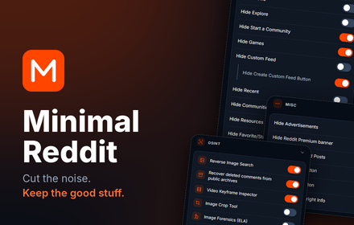
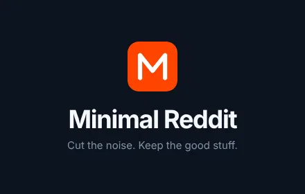

</details>
